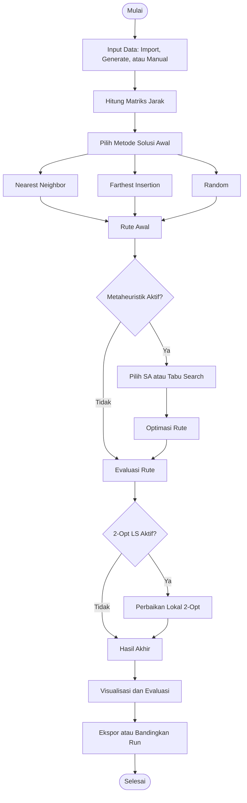

# TSP Optimizer
### Implementasi Algoritma Simulated Annealing dan Tabu Search dengan Heuristik Konstruktif dan 2-Opt Local Search

**Proyek Mata Kuliah Metode Optimasi Metaheuristik — Kelompok 3**

---

## 1. Deskripsi Proyek

**TSP Optimizer** merupakan aplikasi desktop untuk menyelesaikan permasalahan *Traveling Salesman Problem* (TSP), yaitu menentukan rute kunjungan sejumlah kota dengan total jarak minimum. Aplikasi ini mengintegrasikan metode pembentukan solusi awal, algoritma metaheuristik, dan pencarian lokal untuk membantu proses optimasi rute.

Metode pembentukan solusi awal yang tersedia meliputi **Nearest Neighbor**, **Farthest Insertion**, dan **Random**. Pengguna dapat memilih **Simulated Annealing (SA)** atau **Tabu Search (TS)** sebagai metode optimasi, serta mengaktifkan **2-Opt Local Search** sebagai tahap perbaikan tambahan.

Aplikasi menyediakan tiga metode input data, yaitu Import, Generate, dan Manual. Fitur lainnya mencakup pengaturan parameter algoritma, visualisasi rute awal dan akhir, grafik konvergensi, ekspor hasil, perbandingan beberapa run, Log Iterasi, Analisis Parameter, dan Reset. Fitur Analisis Parameter digunakan untuk mengevaluasi pengaruh variasi parameter terhadap hasil optimasi, sedangkan Log Iterasi menampilkan rincian proses pencarian solusi.

---

## 2. Anggota Kelompok

| No. | Nama Anggota | NRP | 
|:---:|--------------|-----|
| 1 | Violita Karina Putri | 5052241009 | 
| 2 | George Eldzen Edison | 5052241024 |
| 3 | Azizah Adilah | 5052241028 | 
| 4 | Aqila Ikhza Kusumawardani | 5052241032 | 
| 5 | Najwa Aulia | 5052241035 | 

---

## 3. Latar Belakang & Case Study

### 3.1 Latar Belakang

Penentuan rute perjalanan yang efisien menjadi salah satu permasalahan penting dalam bidang transportasi dan logistik. Semakin banyak lokasi yang harus dikunjungi, semakin besar pula kemungkinan urutan perjalanan yang dapat dipilih. Permasalahan ini dikenal sebagai *Traveling Salesman Problem* (TSP), yaitu pencarian rute dengan total jarak minimum, di mana setiap lokasi dikunjungi tepat satu kali sebelum kembali ke titik awal.

Untuk menyelesaikan permasalahan tersebut, proyek ini menerapkan pendekatan heuristik konstruktif dalam membentuk solusi awal serta algoritma metaheuristik untuk memperbaiki kualitas rute. Kombinasi metode ini memungkinkan pencarian solusi yang efisien tanpa harus mengevaluasi seluruh kemungkinan rute secara langsung.

### 3.2 Studi Kasus dan Dataset

Studi kasus menggunakan simulasi perjalanan ke enam kota di Jawa Timur, yaitu **Surabaya, Sidoarjo, Gresik, Mojokerto, Malang, dan Blitar**. Perjalanan dimulai dari Surabaya sebagai titik awal (*depot*), mengunjungi seluruh kota lainnya tepat satu kali, kemudian kembali ke Surabaya.

Dataset yang digunakan berasal dari file [`data/City.csv`](data/City.csv) dalam repository proyek. Data tersebut merupakan koordinat contoh dua dimensi untuk pengujian algoritma, bukan koordinat geografis atau jarak jalan sebenarnya.

| No. | Kota | X | Y |
|:---:|------|---:|---:|
| 1 | Surabaya | 0 | 0 |
| 2 | Sidoarjo | 20 | 15 |
| 3 | Gresik | 18 | 30 |
| 4 | Mojokerto | 55 | 40 |
| 5 | Malang | 90 | 45 |
| 6 | Blitar | 110 | 60 |

### 3.3 Perhitungan Jarak Antarkota

Jarak antarkota dalam aplikasi dihitung menggunakan **Euclidean Distance**, yaitu jarak garis lurus antara dua titik berdasarkan koordinat X dan Y. Hasil perhitungan digunakan untuk membentuk matriks jarak sebagai dasar proses optimasi rute.

Rumus Euclidean Distance:

$$
d(i,j) = \sqrt{(x_i-x_j)^2 + (y_i-y_j)^2}
$$

Keterangan:
- $d(i,j)$: jarak antara kota $i$ dan kota $j$.
- $x_i, y_i$: koordinat kota $i$.
- $x_j, y_j$: koordinat kota $j$.

**Contoh:** Jarak Surabaya (0,0) ke Sidoarjo (20,15).

$$
d=\sqrt{(20-0)^2+(15-0)^2}
=\sqrt{625}=25
$$

Hasil perhitungan jarak setiap pasangan kota digunakan untuk membentuk matriks jarak yang menjadi dasar proses optimasi rute.

---

## 4. Landasan Teori

### 4.1 Traveling Salesman Problem (TSP)

*Traveling Salesman Problem* (TSP) merupakan permasalahan optimasi kombinatorial yang bertujuan menentukan rute perjalanan dengan total jarak minimum. Dalam TSP, setiap kota harus dikunjungi tepat satu kali dan perjalanan berakhir dengan kembali ke kota asal. Semakin banyak jumlah kota, semakin besar kemungkinan rute yang terbentuk sehingga diperlukan algoritma untuk mencari solusi secara efisien.

### 4.2 Heuristik Konstruktif

Heuristik konstruktif merupakan pendekatan yang digunakan untuk membentuk solusi awal berdasarkan aturan tertentu. Dalam aplikasi TSP Optimizer, tersedia tiga metode pembentukan solusi awal:

**1. Nearest Neighbor (NN)**

*Nearest Neighbor* membentuk rute dengan memilih kota terdekat yang belum dikunjungi dari posisi saat ini. Proses berulang hingga seluruh kota dikunjungi, kemudian perjalanan kembali ke kota awal. Metode ini sederhana dan cepat, tetapi tidak selalu menghasilkan rute dengan jarak minimum.

**2. Farthest Insertion (FI)**

*Farthest Insertion* membentuk rute secara bertahap dengan memilih kota yang paling jauh dari rute yang telah terbentuk, kemudian menyisipkannya pada posisi yang menghasilkan tambahan jarak terkecil. Proses dilakukan hingga seluruh kota masuk ke dalam rute.

**3. Random**

*Random* membentuk solusi awal dengan mengacak urutan kunjungan kota tanpa mempertimbangkan jarak antarkota. Metode ini digunakan sebagai alternatif solusi awal sekaligus pembanding terhadap metode konstruktif lainnya.

### 4.3 Simulated Annealing (SA)

*Simulated Annealing* merupakan algoritma metaheuristik yang terinspirasi dari proses pendinginan material dalam metalurgi. Algoritma ini mencari solusi yang lebih baik dengan mengevaluasi perubahan rute dan menggunakan probabilitas untuk menentukan penerimaan solusi baru.

Solusi yang memiliki jarak lebih pendek akan diterima, sedangkan solusi yang lebih buruk masih dapat diterima berdasarkan probabilitas yang dipengaruhi oleh suhu (*temperature*). Seiring penurunan suhu, kemungkinan menerima solusi yang lebih buruk semakin kecil. Mekanisme tersebut membantu algoritma keluar dari kondisi optimum lokal dan memperluas pencarian solusi.

### 4.4 Tabu Search (TS)

*Tabu Search* merupakan algoritma metaheuristik yang menggunakan mekanisme memori berupa *tabu list* untuk menghindari pengulangan gerakan pencarian tertentu. Algoritma mengevaluasi sejumlah solusi tetangga dan memilih kandidat terbaik yang memenuhi aturan tabu.

Berbeda dengan pencarian lokal biasa, Tabu Search dapat menerima solusi yang lebih buruk untuk menjelajahi ruang pencarian yang lebih luas. Gerakan yang masuk ke dalam *tabu list* dibatasi sementara, tetapi dapat diterima kembali melalui *aspiration criterion* apabila menghasilkan solusi terbaik baru.

### 4.5 2-Opt

*2-Opt* merupakan metode optimasi rute yang bekerja dengan memilih dua sisi pada rute, kemudian menyambungkan kembali sisi tersebut dengan membalik urutan kota pada segmen tertentu. Perubahan ini menghasilkan solusi tetangga yang dapat dievaluasi berdasarkan total jaraknya. Solusi dengan jarak lebih pendek menunjukkan perbaikan terhadap rute sebelumnya.

Dalam aplikasi TSP Optimizer, 2-Opt memiliki dua fungsi. Pertama, 2-Opt dapat digunakan sebagai operator perpindahan (*move operator*) selama proses pencarian metaheuristik untuk menghasilkan kandidat rute baru. Kedua, **2-Opt Local Search** dapat diaktifkan sebagai tahap perbaikan tambahan setelah metaheuristik selesai. Pada tahap ini, perbaikan dilakukan selama masih ditemukan perubahan yang mengurangi jarak hingga mencapai optimum lokal atau kondisi berhenti yang ditetapkan.

Kedua fungsi tersebut memiliki perbedaan dalam penerapannya. Sebagai operator perpindahan, 2-Opt menjadi bagian dari proses pencarian solusi oleh metaheuristik. Sebagai *Local Search*, 2-Opt berfokus pada perbaikan rute yang telah dihasilkan. Dengan demikian, aplikasi memungkinkan pengguna mengatur penggunaan 2-Opt sesuai kebutuhan optimasi.

### 4.6 Ringkasan Metode

| Metode | Kategori | Fungsi |
|--------|----------|--------|
| Nearest Neighbor | Heuristik konstruktif | Membentuk rute awal berdasarkan kota terdekat |
| Farthest Insertion | Heuristik konstruktif | Membentuk rute awal melalui penyisipan kota terjauh |
| Random | Inisialisasi acak | Membentuk rute awal secara acak |
| Simulated Annealing | Metaheuristik | Mengoptimalkan rute menggunakan probabilitas penerimaan solusi |
| Tabu Search | Metaheuristik | Mengoptimalkan rute menggunakan memori tabu |
| 2-Opt Move Operator | Operator perpindahan | Membentuk kandidat rute melalui pembalikan segmen selama pencarian metaheuristik |
| 2-Opt Local Search | Pencarian lokal | Memperbaiki rute setelah metaheuristik hingga mencapai optimum lokal atau kondisi berhenti |

---

## 5. Metodologi dan Pipeline

### 5.1 Metodologi

Proses optimasi dimulai dengan memasukkan data kota melalui **Import**, **Generate**, atau **Manual**. Data yang tersedia kemudian digunakan untuk menghitung jarak antarkota sebagai dasar pembentukan rute.

Pengguna memilih metode pembentukan solusi awal, yaitu **Nearest Neighbor**, **Farthest Insertion**, atau **Random**. Rute awal dapat dioptimalkan menggunakan **Simulated Annealing** atau **Tabu Search** apabila fitur metaheuristik diaktifkan. Pengguna juga dapat mengatur parameter algoritma dan seed sesuai kebutuhan pengujian.

Setelah pencarian metaheuristik selesai, pengguna dapat mengaktifkan **2-Opt Local Search** untuk melakukan perbaikan lokal tambahan. Jika metaheuristik tidak diaktifkan, proses dilanjutkan tanpa tahap tersebut. Hasil akhir ditampilkan melalui visualisasi rute, informasi jarak, grafik konvergensi, dan urutan rute. Aplikasi juga menyediakan fitur ekspor dan perbandingan hasil percobaan.

### 5.2 Flowchart Pipeline

### 5.3 Tahapan Proses Optimasi

| Tahap | Proses | Keterangan |
|:---:|---|---|
| 1 | Input Data | Memuat, membuat, atau memasukkan data kota |
| 2 | Perhitungan Jarak | Menghitung jarak antarkota berdasarkan koordinat |
| 3 | Solusi Awal | Membentuk rute menggunakan NN, Farthest Insertion, atau Random |
| 4 | Optimasi Metaheuristik | Menjalankan SA atau TS jika diaktifkan |
| 5 | Perbaikan Lokal | Menjalankan 2-Opt LS jika diaktifkan |
| 6 | Evaluasi | Menampilkan rute, jarak, konvergensi, dan urutan kota |
| 7 | Dokumentasi | Mengekspor hasil atau membandingkan beberapa run |

---

## 6. Cara Instalasi dan Menjalankan Aplikasi

TSP Optimizer v1.0 tersedia dalam paket installer Windows yang disediakan pada distribusi aplikasi. Pengguna dapat menjalankan versi installer tanpa perlu memasang Python atau library pemrograman secara terpisah.

### 6.1 Instalasi Windows

1. Unduh file ZIP installer Windows dari repository atau sumber distribusi aplikasi.
2. Ekstrak file ZIP ke folder yang diinginkan.
3. Jalankan `TSP-Optimizer-Setup-v1.0.exe`.
4. Ikuti petunjuk instalasi hingga selesai.
5. Buka **TSP Optimizer** melalui shortcut atau lokasi instalasi yang tersedia.

Jika Windows menampilkan peringatan keamanan, pastikan installer berasal dari sumber yang dipercaya sebelum melanjutkan.

### 6.2 Menjalankan Aplikasi

Setelah instalasi selesai, buka **TSP Optimizer**. Panel sebelah kiri digunakan untuk memasukkan data dan mengatur algoritma, sedangkan panel utama menampilkan visualisasi rute dan hasil optimasi.

Pengguna dapat memulai pengujian dengan mengimpor dataset, membuat data otomatis melalui Generate, atau memasukkan data melalui tabel Manual.

---

## 7. Tutorial Penggunaan Aplikasi

### 7.1 Memasukkan Data Kota

Aplikasi menyediakan tiga tab untuk memasukkan data.

- **Import:** Mengunggah file CSV/Excel dan mengunduh template data.
- **Generate:** Membuat data kota secara otomatis dengan menentukan jumlah titik, seed, batas koordinat X/Y, dan pola sebaran yang tersedia.
- **Manual:** Membuka tabel input untuk memasukkan atau mengedit data kota.

Untuk file CSV, gunakan kolom `name`, `x`, dan `y` sebagai kolom wajib. Kolom `no` bersifat opsional. Baris pertama digunakan sebagai depot sesuai ketentuan format data aplikasi.

  

### 7.2 Mengatur Metode Optimasi

Pada bagian **Inisialisasi Rute**, pilih metode pembentukan solusi awal, yaitu **Nearest Neighbor**, **Farthest Insertion**, atau **Random**. Seed dapat digunakan untuk mengatur percobaan yang melibatkan proses acak.

Aktifkan **Gunakan metaheuristik** apabila ingin menggunakan **Simulated Annealing** atau **Tabu Search**. Sesuaikan parameter algoritma yang tersedia. Parameter Simulated Annealing mencakup suhu awal, laju pendinginan, suhu minimum, batas iterasi, dan operator perpindahan.

Pengguna juga dapat mengaktifkan **2-Opt Local Search** sebagai tahap perbaikan tambahan. Fitur ini berbeda dari operator perpindahan yang digunakan selama pencarian metaheuristik.

  

  

### 7.3 Menjalankan Optimasi

Setelah data dan konfigurasi ditentukan, klik tombol **JALANKAN** untuk memulai proses optimasi. Aplikasi membentuk solusi awal, menjalankan metaheuristik apabila diaktifkan, dan menerapkan 2-Opt Local Search apabila dipilih.

Setelah proses selesai, hasil perhitungan dan informasi proses optimasi ditampilkan pada panel utama.

### 7.4 Melihat Hasil Optimasi

Hasil optimasi ditampilkan melalui beberapa komponen berikut.

| Komponen | Keterangan |
|---|---|
| **Peta Rute** | Menampilkan visualisasi perjalanan antarkota |
| **Awal** | Menampilkan rute sebelum optimasi |
| **Akhir** | Menampilkan rute hasil akhir |
| **Keduanya** | Menampilkan rute awal dan akhir untuk perbandingan visual |
| **Jarak Awal** | Total jarak rute sebelum optimasi |
| **Hasil Metaheuristik** | Total jarak setelah tahap metaheuristik |
| **Setelah 2-Opt LS** | Total jarak setelah perbaikan lokal, jika diterapkan |
| **Total Gain** | Menampilkan perubahan jarak dan persentase perbaikan |
| **Konvergensi** | Menampilkan perkembangan nilai solusi selama pencarian |
| **Urutan Rute** | Menampilkan urutan kunjungan kota |

Nilai jarak dan gain perlu dibaca sesuai tahap optimasi yang ditampilkan. Grafik konvergensi membantu mengamati perkembangan solusi selama proses pencarian.

### 7.5 Mengekspor dan Membandingkan Hasil

Aplikasi menyediakan fitur untuk menyimpan hasil optimasi dan membandingkan beberapa percobaan.

- **Export:** Mengekspor hasil optimasi.
- **Bandingkan:** Membandingkan hasil beberapa *run* berdasarkan konfigurasi algoritma.
- **Reset:** Mengatur ulang kondisi aplikasi sesuai fungsi yang tersedia.

Fitur Bandingkan menampilkan konfigurasi metode, jarak awal dan akhir, *gain*, jumlah iterasi, waktu komputasi, serta kriteria berhenti. Informasi tersebut membantu pengguna mengevaluasi perbedaan hasil dari beberapa percobaan.

**Tampilan Perbandingan Run**

### 7.6 Melakukan Analisis Parameter

Fitur **Analisis Parameter** digunakan untuk mengamati pengaruh perubahan nilai parameter terhadap hasil optimasi. Pengguna dapat memilih algoritma, parameter yang diuji, daftar nilai parameter, jumlah pengulangan, serta opsi 2-Opt Local Search.

Setiap nilai parameter diuji melalui beberapa pengulangan dengan *seed* yang berbeda. Hasilnya disajikan dalam tabel yang memuat nilai terbaik (*best*), rata-rata, terburuk (*worst*), standar deviasi (*std*), *gain* rata-rata, rata-rata iterasi, dan rata-rata waktu komputasi.

Aplikasi juga menyediakan grafik distribusi jarak akhir serta perbandingan waktu komputasi dan jumlah iterasi. Pengguna dapat menjalankan analisis melalui tombol **Jalankan** dan menyimpan hasilnya melalui tombol **Export**.

**Tampilan Analisis Parameter**

### 7.7 Melihat Log Iterasi

Fitur **Log Iterasi** digunakan untuk memeriksa proses pencarian solusi selama algoritma berjalan. Informasi yang ditampilkan mencakup nomor iterasi, suhu, gerakan yang dipilih (*move*), perubahan nilai objektif, probabilitas penerimaan, bilangan acak, keputusan penerimaan atau penolakan, nilai solusi saat ini (*current*), dan solusi terbaik (*best*).

Pengguna dapat memfilter catatan berdasarkan kondisi yang tersedia, seperti iterasi ketika solusi terbaik membaik atau ketika gerakan diterima. Tombol **Export log** digunakan untuk mengekspor catatan iterasi sebagai bahan dokumentasi dan analisis.

Bagian bawah jendela menampilkan informasi kondisi berhenti, jumlah iterasi, dan parameter yang digunakan dalam proses optimasi. Informasi ini membantu pengguna memahami jalannya algoritma hingga proses pencarian berakhir.

**Tampilan Log Iterasi**

---
