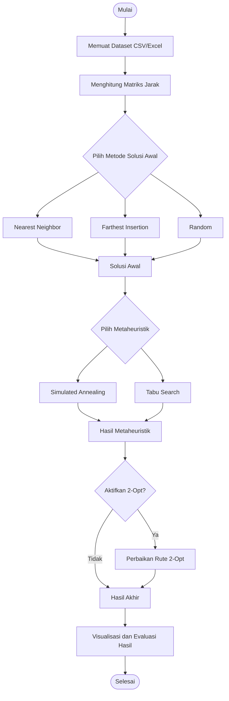

# TSP Optimizer
### Implementasi Algoritma Simulated Annealing dan Tabu Search dengan Heuristik Konstruktif dan 2-Opt Local Search

**Proyek Mata Kuliah Metode Optimasi Metaheuristik — Kelompok ...**

---

## 1. Deskripsi Proyek

**TSP Optimizer** merupakan aplikasi desktop berbasis Python untuk menyelesaikan permasalahan *Traveling Salesman Problem* (TSP), yaitu pencarian rute perjalanan dengan total jarak minimum. Aplikasi ini memungkinkan pengguna menentukan urutan kunjungan sejumlah kota melalui proses pembentukan solusi awal, optimasi rute, dan visualisasi hasil perhitungan.

Aplikasi menggunakan tiga metode pembentukan solusi awal, yaitu **Nearest Neighbor (NN)**, **Farthest Insertion**, dan **Random**. Proses optimasi dilakukan menggunakan **Simulated Annealing (SA)** atau **Tabu Search (TS)**, dengan **2-Opt Local Search** sebagai tahap perbaikan tambahan yang bersifat opsional. Aplikasi dikembangkan menggunakan **Python** dan **CustomTkinter**, serta mendukung input dataset CSV/Excel, pengaturan parameter algoritma, visualisasi rute, grafik konvergensi, dan ekspor hasil optimasi.

---

## 2. Anggota Kelompok

| No. | Nama Anggota | NIM | Pembagian Tugas |
|:---:|--------------|-----|-----------------|
| 1 | Violita Karina Putri | 5052241009 | [Tugas] |
| 2 | George Eldzen Edison | 5052241024 | [Tugas] |
| 3 | Azizah Adilah | 5052241028 | [Tugas] |
| 4 | Aqila Ikhza Kusumawardani | 5052241032 | [Tugas] |
| 5 | Najwa Aulia | 5052241035 | [Tugas] |

---

## 3. Latar Belakang & Case Study

### 3.1 Latar Belakang

Penentuan rute perjalanan yang efisien menjadi salah satu permasalahan penting dalam bidang transportasi dan logistik. Semakin banyak lokasi yang harus dikunjungi, semakin besar pula kemungkinan urutan perjalanan yang dapat dipilih. Permasalahan ini dikenal sebagai *Traveling Salesman Problem* (TSP), yaitu pencarian rute dengan total jarak minimum, di mana setiap lokasi dikunjungi tepat satu kali sebelum kembali ke titik awal.

Untuk menyelesaikan permasalahan tersebut, proyek ini menerapkan pendekatan heuristik konstruktif dalam membentuk solusi awal serta algoritma metaheuristik untuk memperbaiki kualitas rute. Kombinasi metode ini memungkinkan pencarian solusi yang efisien tanpa harus mengevaluasi seluruh kemungkinan rute secara langsung.

### 3.2 Studi Kasus dan Dataset

Studi kasus menggunakan simulasi perjalanan ke enam kota di Jawa Timur, yaitu **Surabaya, Sidoarjo, Gresik, Mojokerto, Malang, dan Blitar**. Perjalanan dimulai dari Surabaya sebagai titik awal (*depot*), mengunjungi seluruh kota lainnya tepat satu kali, kemudian kembali ke Surabaya.

Dataset yang digunakan berasal dari file [`data/City.csv`](data/City.csv) dalam repository proyek. Data tersebut merupakan koordinat contoh dua dimensi untuk pengujian algoritma, bukan koordinat geografis atau jarak jalan sebenarnya.

| No. | Kota | X | Y |
|:---:|------|---:|---:|
| 1 | Surabaya | 0 | 0 |
| 2 | Sidoarjo | 20 | 15 |
| 3 | Gresik | 18 | 30 |
| 4 | Mojokerto | 55 | 40 |
| 5 | Malang | 90 | 45 |
| 6 | Blitar | 110 | 60 |


### 3.3 Perhitungan Jarak Antarkota

Jarak antarkota dalam aplikasi dihitung menggunakan **Euclidean Distance**, yaitu jarak garis lurus antara dua titik berdasarkan koordinat X dan Y. Hasil perhitungan digunakan untuk membentuk matriks jarak sebagai dasar proses optimasi rute.

Rumus Euclidean Distance:

$$
d(i,j) = \sqrt{(x_i-x_j)^2 + (y_i-y_j)^2}
$$

Keterangan:
- $d(i,j)$: jarak antara kota $i$ dan kota $j$.
- $x_i, y_i$: koordinat kota $i$.
- $x_j, y_j$: koordinat kota $j$.


**Contoh:** Jarak Surabaya (0,0) ke Sidoarjo (20,15).

$$
d=\sqrt{(20-0)^2+(15-0)^2}
=\sqrt{625}=25
$$

Hasil perhitungan jarak setiap pasangan kota digunakan untuk membentuk matriks jarak yang menjadi dasar proses optimasi rute.

---


## 4. Landasan Teori

### 4.1 Traveling Salesman Problem (TSP)

*Traveling Salesman Problem* (TSP) merupakan permasalahan optimasi kombinatorial yang bertujuan menentukan rute perjalanan dengan total jarak minimum. Dalam TSP, setiap kota harus dikunjungi tepat satu kali dan perjalanan berakhir dengan kembali ke kota asal. Semakin banyak jumlah kota, semakin besar kemungkinan rute yang terbentuk sehingga diperlukan algoritma untuk mencari solusi secara efisien.

### 4.2 Heuristik Konstruktif

Heuristik konstruktif merupakan pendekatan yang digunakan untuk membentuk solusi awal berdasarkan aturan tertentu. Dalam aplikasi TSP Optimizer, tersedia tiga metode pembentukan solusi awal:

**1. Nearest Neighbor (NN)**

*Nearest Neighbor* membentuk rute dengan memilih kota terdekat yang belum dikunjungi dari posisi saat ini. Proses berulang hingga seluruh kota dikunjungi, kemudian perjalanan kembali ke kota awal. Metode ini sederhana dan cepat, tetapi tidak selalu menghasilkan rute dengan jarak minimum.

**2. Farthest Insertion (FI)**

*Farthest Insertion* membentuk rute secara bertahap dengan memilih kota yang paling jauh dari rute yang telah terbentuk, kemudian menyisipkannya pada posisi yang menghasilkan tambahan jarak terkecil. Proses dilakukan hingga seluruh kota masuk ke dalam rute.

**3. Random**

*Random* membentuk solusi awal dengan mengacak urutan kunjungan kota tanpa mempertimbangkan jarak antarkota. Metode ini digunakan sebagai alternatif solusi awal sekaligus pembanding terhadap metode konstruktif lainnya.

### 4.3 Simulated Annealing (SA)

*Simulated Annealing* merupakan algoritma metaheuristik yang terinspirasi dari proses pendinginan material dalam metalurgi. Algoritma ini mencari solusi yang lebih baik dengan mengevaluasi perubahan rute dan menggunakan probabilitas untuk menentukan penerimaan solusi baru.

Solusi yang memiliki jarak lebih pendek akan diterima, sedangkan solusi yang lebih buruk masih dapat diterima berdasarkan probabilitas yang dipengaruhi oleh suhu (*temperature*). Seiring penurunan suhu, kemungkinan menerima solusi yang lebih buruk semakin kecil. Mekanisme tersebut membantu algoritma keluar dari kondisi optimum lokal dan memperluas pencarian solusi.

### 4.4 Tabu Search (TS)

*Tabu Search* merupakan algoritma metaheuristik yang menggunakan mekanisme memori berupa *tabu list* untuk menghindari pengulangan gerakan pencarian tertentu. Algoritma mengevaluasi sejumlah solusi tetangga dan memilih kandidat terbaik yang memenuhi aturan tabu.

Berbeda dengan pencarian lokal biasa, Tabu Search dapat menerima solusi yang lebih buruk untuk menjelajahi ruang pencarian yang lebih luas. Gerakan yang masuk ke dalam *tabu list* dibatasi sementara, tetapi dapat diterima kembali melalui *aspiration criterion* apabila menghasilkan solusi terbaik baru.

### 4.5 2-Opt Local Search

*2-Opt* merupakan metode pencarian lokal yang memperbaiki rute dengan memilih dua posisi dan membalik urutan kota di antara kedua posisi tersebut. Perubahan diterima apabila menghasilkan total jarak yang lebih pendek dibandingkan rute sebelumnya.

Proses perbaikan dilakukan secara berulang hingga tidak ditemukan perubahan yang dapat mengurangi jarak perjalanan. Dalam aplikasi TSP Optimizer, 2-Opt digunakan sebagai tahap penyempurnaan setelah optimasi Simulated Annealing atau Tabu Search dan dapat diaktifkan atau dinonaktifkan oleh pengguna.

### 4.6 Ringkasan Metode

| Metode | Kategori | Fungsi |
|--------|----------|--------|
| Nearest Neighbor | Heuristik konstruktif | Membentuk rute awal berdasarkan kota terdekat |
| Farthest Insertion | Heuristik konstruktif | Membentuk rute awal melalui penyisipan kota terjauh |
| Random | Inisialisasi acak | Membentuk rute awal secara acak |
| Simulated Annealing | Metaheuristik | Mengoptimalkan rute menggunakan probabilitas penerimaan solusi |
| Tabu Search | Metaheuristik | Mengoptimalkan rute menggunakan memori tabu |
| 2-Opt | Local Search | Memperbaiki rute melalui pembalikan segmen |

---


## 5. Metodologi & Pipeline

### 5.1 Metodologi

Proses optimasi pada aplikasi **TSP Optimizer** dilakukan melalui tiga tahap utama, yaitu pembentukan solusi awal menggunakan metode konstruktif, optimasi menggunakan algoritma metaheuristik, dan perbaikan tambahan menggunakan 2-Opt Local Search.

Tahap pertama dimulai dengan memuat dataset kota dan menghitung matriks jarak menggunakan Euclidean Distance. Selanjutnya, pengguna memilih salah satu metode pembentukan solusi awal, yaitu Nearest Neighbor, Farthest Insertion, atau Random.

Rute awal kemudian dioptimalkan menggunakan Simulated Annealing atau Tabu Search sesuai pilihan pengguna. Setelah proses metaheuristik selesai, hasilnya dapat diperbaiki kembali menggunakan 2-Opt apabila fitur tersebut diaktifkan. Aplikasi kemudian menampilkan rute akhir, total jarak, persentase perbaikan, serta visualisasi hasil optimasi.

### 5.2 Flowchart Pipeline



### 5.3 Tahapan Proses Optimasi

| Tahap | Proses | Keterangan |
|:---:|--------|------------|
| 1 | Input Dataset | Membaca data kota dari file CSV atau Excel |
| 2 | Perhitungan Jarak | Membentuk matriks jarak menggunakan Euclidean Distance |
| 3 | Solusi Awal | Menggunakan NN, Farthest Insertion, atau Random |
| 4 | Optimasi Metaheuristik | Menggunakan Simulated Annealing atau Tabu Search |
| 5 | Perbaikan Lokal | Menerapkan 2-Opt apabila diaktifkan |
| 6 | Output | Menampilkan rute akhir, jarak, grafik, dan hasil optimasi |

---


## 6. Perhitungan Manual

---


## 7. Cara Instalasi & Menjalankan Aplikasi

Aplikasi **TSP Optimizer** dikembangkan menggunakan Python dengan antarmuka desktop berbasis CustomTkinter. Untuk menjalankannya, pengguna perlu menginstal Python dan library yang tercantum dalam `requirements.txt`.

### 7.1 Persyaratan Sistem

- Python 3.10 atau lebih baru (disarankan).
- Git (opsional, untuk mengunduh repository).
- Sistem operasi yang mendukung antarmuka desktop Python.
- Library Python sesuai file `requirements.txt`.

### 7.2 Instalasi

**1. Clone repository**

Buka terminal atau Command Prompt, kemudian jalankan:

```bash
git clone -b dev-app https://github.com/Violita-archive/tsp-metaheuristic.git
cd tsp-metaheuristic
```

Alternatifnya, pengguna dapat mengunduh repository melalui **Code → Download ZIP**, kemudian mengekstraknya.

**2. Instal dependensi**

Jalankan perintah berikut dari direktori utama proyek:

```bash
python -m pip install -r requirements.txt
```

**3. Jalankan aplikasi**

Setelah proses instalasi selesai, jalankan:

```bash
python app/main.py
```

Jika berhasil, jendela **TSP Metaheuristic Optimizer** akan terbuka dan aplikasi siap digunakan.

> **Catatan:** Pada Windows, perintah `python` dapat diganti dengan `py` apabila menggunakan Python Launcher.

---

