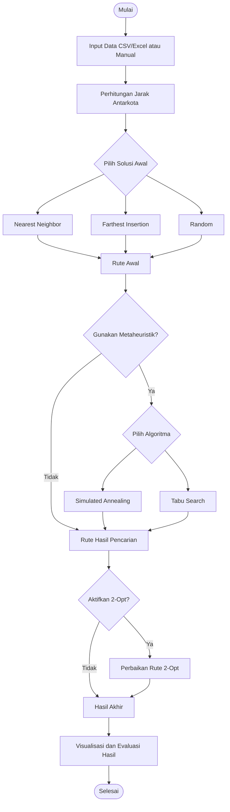

# TSP Optimizer
### Implementasi Algoritma Simulated Annealing dan Tabu Search dengan Heuristik Konstruktif dan 2-Opt Local Search

**Proyek Mata Kuliah Metode Optimasi Metaheuristik — Kelompok ...**

---

## 1. Deskripsi Proyek

**TSP Optimizer** merupakan aplikasi desktop untuk menyelesaikan permasalahan *Traveling Salesman Problem* (TSP), yaitu menentukan rute kunjungan sejumlah kota dengan total jarak minimum. Aplikasi ini menyediakan metode pembentukan solusi awal, optimasi rute, serta visualisasi hasil perhitungan dalam antarmuka yang interaktif.

Metode pembentukan solusi awal terdiri dari **Nearest Neighbor**, **Farthest Insertion**, dan **Random**. Pengguna dapat menerapkan algoritma metaheuristik **Simulated Annealing (SA)** atau **Tabu Search (TS)**, serta menggunakan **2-Opt Local Search** sebagai perbaikan tambahan.

Aplikasi mendukung input data melalui CSV/Excel maupun secara manual, pengaturan metode optimasi, visualisasi rute, grafik konvergensi, ekspor hasil, serta fitur perbandingan run. TSP Optimizer v1.0 tersedia dalam bentuk aplikasi desktop untuk Windows dan macOS sehingga pengguna dapat menjalankannya tanpa perlu memasang Python secara terpisah.

---

## 2. Anggota Kelompok

| No. | Nama Anggota | NIM | Pembagian Tugas |
|:---:|--------------|-----|-----------------|
| 1 | Violita Karina Putri | 5052241009 | [Tugas] |
| 2 | George Eldzen Edison | 5052241024 | [Tugas] |
| 3 | Azizah Adilah | 5052241028 | [Tugas] |
| 4 | Aqila Ikhza Kusumawardani | 5052241032 | [Tugas] |
| 5 | Najwa Aulia | 5052241035 | [Tugas] |

---

## 3. Latar Belakang & Case Study

### 3.1 Latar Belakang

Penentuan rute perjalanan yang efisien menjadi salah satu permasalahan penting dalam bidang transportasi dan logistik. Semakin banyak lokasi yang harus dikunjungi, semakin besar pula kemungkinan urutan perjalanan yang dapat dipilih. Permasalahan ini dikenal sebagai *Traveling Salesman Problem* (TSP), yaitu pencarian rute dengan total jarak minimum, di mana setiap lokasi dikunjungi tepat satu kali sebelum kembali ke titik awal.

Untuk menyelesaikan permasalahan tersebut, proyek ini menerapkan pendekatan heuristik konstruktif dalam membentuk solusi awal serta algoritma metaheuristik untuk memperbaiki kualitas rute. Kombinasi metode ini memungkinkan pencarian solusi yang efisien tanpa harus mengevaluasi seluruh kemungkinan rute secara langsung.

### 3.2 Studi Kasus dan Dataset

Studi kasus menggunakan simulasi perjalanan ke enam kota di Jawa Timur, yaitu **Surabaya, Sidoarjo, Gresik, Mojokerto, Malang, dan Blitar**. Perjalanan dimulai dari Surabaya sebagai titik awal (*depot*), mengunjungi seluruh kota lainnya tepat satu kali, kemudian kembali ke Surabaya.

Dataset yang digunakan berasal dari file [`data/City.csv`](data/City.csv) dalam repository proyek. Data tersebut merupakan koordinat contoh dua dimensi untuk pengujian algoritma, bukan koordinat geografis atau jarak jalan sebenarnya.

| No. | Kota | X | Y |
|:---:|------|---:|---:|
| 1 | Surabaya | 0 | 0 |
| 2 | Sidoarjo | 20 | 15 |
| 3 | Gresik | 18 | 30 |
| 4 | Mojokerto | 55 | 40 |
| 5 | Malang | 90 | 45 |
| 6 | Blitar | 110 | 60 |

### 3.3 Perhitungan Jarak Antarkota

Jarak antarkota dalam aplikasi dihitung menggunakan **Euclidean Distance**, yaitu jarak garis lurus antara dua titik berdasarkan koordinat X dan Y. Hasil perhitungan digunakan untuk membentuk matriks jarak sebagai dasar proses optimasi rute.

Rumus Euclidean Distance:

$$
d(i,j) = \sqrt{(x_i-x_j)^2 + (y_i-y_j)^2}
$$

Keterangan:
- $d(i,j)$: jarak antara kota $i$ dan kota $j$.
- $x_i, y_i$: koordinat kota $i$.
- $x_j, y_j$: koordinat kota $j$.

**Contoh:** Jarak Surabaya (0,0) ke Sidoarjo (20,15).

$$
d=\sqrt{(20-0)^2+(15-0)^2}
=\sqrt{625}=25
$$

Hasil perhitungan jarak setiap pasangan kota digunakan untuk membentuk matriks jarak yang menjadi dasar proses optimasi rute.

---

## 4. Landasan Teori

### 4.1 Traveling Salesman Problem (TSP)

*Traveling Salesman Problem* (TSP) merupakan permasalahan optimasi kombinatorial yang bertujuan menentukan rute perjalanan dengan total jarak minimum. Dalam TSP, setiap kota harus dikunjungi tepat satu kali dan perjalanan berakhir dengan kembali ke kota asal. Semakin banyak jumlah kota, semakin besar kemungkinan rute yang terbentuk sehingga diperlukan algoritma untuk mencari solusi secara efisien.

### 4.2 Heuristik Konstruktif

Heuristik konstruktif merupakan pendekatan yang digunakan untuk membentuk solusi awal berdasarkan aturan tertentu. Dalam aplikasi TSP Optimizer, tersedia tiga metode pembentukan solusi awal:

**1. Nearest Neighbor (NN)**

*Nearest Neighbor* membentuk rute dengan memilih kota terdekat yang belum dikunjungi dari posisi saat ini. Proses berulang hingga seluruh kota dikunjungi, kemudian perjalanan kembali ke kota awal. Metode ini sederhana dan cepat, tetapi tidak selalu menghasilkan rute dengan jarak minimum.

**2. Farthest Insertion (FI)**

*Farthest Insertion* membentuk rute secara bertahap dengan memilih kota yang paling jauh dari rute yang telah terbentuk, kemudian menyisipkannya pada posisi yang menghasilkan tambahan jarak terkecil. Proses dilakukan hingga seluruh kota masuk ke dalam rute.

**3. Random**

*Random* membentuk solusi awal dengan mengacak urutan kunjungan kota tanpa mempertimbangkan jarak antarkota. Metode ini digunakan sebagai alternatif solusi awal sekaligus pembanding terhadap metode konstruktif lainnya.

### 4.3 Simulated Annealing (SA)

*Simulated Annealing* merupakan algoritma metaheuristik yang terinspirasi dari proses pendinginan material dalam metalurgi. Algoritma ini mencari solusi yang lebih baik dengan mengevaluasi perubahan rute dan menggunakan probabilitas untuk menentukan penerimaan solusi baru.

Solusi yang memiliki jarak lebih pendek akan diterima, sedangkan solusi yang lebih buruk masih dapat diterima berdasarkan probabilitas yang dipengaruhi oleh suhu (*temperature*). Seiring penurunan suhu, kemungkinan menerima solusi yang lebih buruk semakin kecil. Mekanisme tersebut membantu algoritma keluar dari kondisi optimum lokal dan memperluas pencarian solusi.

### 4.4 Tabu Search (TS)

*Tabu Search* merupakan algoritma metaheuristik yang menggunakan mekanisme memori berupa *tabu list* untuk menghindari pengulangan gerakan pencarian tertentu. Algoritma mengevaluasi sejumlah solusi tetangga dan memilih kandidat terbaik yang memenuhi aturan tabu.

Berbeda dengan pencarian lokal biasa, Tabu Search dapat menerima solusi yang lebih buruk untuk menjelajahi ruang pencarian yang lebih luas. Gerakan yang masuk ke dalam *tabu list* dibatasi sementara, tetapi dapat diterima kembali melalui *aspiration criterion* apabila menghasilkan solusi terbaik baru.

### 4.5 2-Opt Local Search

*2-Opt* merupakan metode pencarian lokal yang memperbaiki rute dengan memilih dua posisi dan membalik urutan kota di antara kedua posisi tersebut. Perubahan diterima apabila menghasilkan total jarak yang lebih pendek dibandingkan rute sebelumnya.

Proses perbaikan dilakukan secara berulang hingga tidak ditemukan perubahan yang dapat mengurangi jarak perjalanan. Dalam aplikasi TSP Optimizer, 2-Opt digunakan sebagai tahap penyempurnaan setelah optimasi Simulated Annealing atau Tabu Search dan dapat diaktifkan atau dinonaktifkan oleh pengguna.

### 4.6 Ringkasan Metode

| Metode | Kategori | Fungsi |
|--------|----------|--------|
| Nearest Neighbor | Heuristik konstruktif | Membentuk rute awal berdasarkan kota terdekat |
| Farthest Insertion | Heuristik konstruktif | Membentuk rute awal melalui penyisipan kota terjauh |
| Random | Inisialisasi acak | Membentuk rute awal secara acak |
| Simulated Annealing | Metaheuristik | Mengoptimalkan rute menggunakan probabilitas penerimaan solusi |
| Tabu Search | Metaheuristik | Mengoptimalkan rute menggunakan memori tabu |
| 2-Opt | Local Search | Memperbaiki rute melalui pembalikan segmen |

---

## 5. Metodologi & Pipeline

### 5.1 Metodologi

Proses optimasi pada aplikasi **TSP Optimizer** dimulai dengan memasukkan data kota melalui file CSV/Excel atau input manual. Data tersebut kemudian digunakan untuk menghitung jarak antarkota sebagai dasar pembentukan rute perjalanan.

Selanjutnya, pengguna memilih metode pembentukan solusi awal, yaitu **Nearest Neighbor**, **Farthest Insertion**, atau **Random**. Rute awal dapat dioptimalkan menggunakan algoritma **Simulated Annealing** atau **Tabu Search** apabila fitur metaheuristik diaktifkan.

Setelah itu, pengguna dapat menerapkan **2-Opt Local Search** sebagai perbaikan tambahan. Hasil akhir ditampilkan melalui peta rute, total jarak, grafik konvergensi, dan urutan kunjungan kota. Aplikasi juga menyediakan fitur ekspor dan perbandingan hasil percobaan.

### 5.2 Flowchart Pipeline

### 5.3 Tahapan Proses Optimasi

| Tahap | Proses | Keterangan |
|:---:|--------|------------|
| 1 | Input Data | Memasukkan data kota melalui CSV/Excel atau input manual |
| 2 | Perhitungan Jarak | Menghitung jarak antarkota untuk proses optimasi |
| 3 | Solusi Awal | Membentuk rute menggunakan NN, Farthest Insertion, atau Random |
| 4 | Optimasi Metaheuristik | Menjalankan SA atau Tabu Search apabila diaktifkan |
| 5 | Perbaikan Lokal | Menerapkan 2-Opt apabila diaktifkan |
| 6 | Output & Evaluasi | Menampilkan rute, jarak, grafik konvergensi, dan hasil optimasi |

---

## 6. Perhitungan Manual

---

## 7. Cara Instalasi & Menjalankan Aplikasi

**TSP Optimizer v1.0** tersedia sebagai aplikasi desktop untuk Windows dan macOS. Pengguna tidak perlu menginstal Python, VS Code, maupun library tambahan untuk menjalankan versi installer.

### 7.1 Instalasi Windows

1. Unduh dan ekstrak file `TSP-Optimizer-v1.0.zip`.
2. Buka folder `Windows`.
3. Jalankan `TSP-Optimizer-Setup-v1.0.exe`.
4. Ikuti petunjuk instalasi hingga selesai.
5. Buka **TSP Optimizer** melalui Start Menu atau shortcut Desktop.

### 7.2 Instalasi macOS

Versi macOS yang disediakan ditujukan untuk perangkat Apple Silicon (M1/M2/M3/M4).

1. Buka folder `Mac`.
2. Jalankan `TSP-Optimizer-v1.0.dmg`.
3. Pindahkan aplikasi **TSP Optimizer** ke folder Applications.
4. Buka aplikasi melalui folder Applications.

> **Catatan:** Karena aplikasi belum ditandatangani secara digital, sistem operasi mungkin menampilkan peringatan keamanan. Pastikan file berasal dari repository atau pengembang yang dipercaya sebelum memberikan izin menjalankan aplikasi.

### 7.3 Menjalankan Aplikasi

Setelah instalasi selesai, buka **TSP Optimizer**. Jendela utama aplikasi akan menampilkan panel input data dan konfigurasi algoritma di sebelah kiri, serta hasil optimasi dan visualisasi rute di sebelah kanan.

---

## 8. Tutorial Penggunaan Aplikasi

### 8.1 Memasukkan Data Kota

Buka aplikasi **TSP Optimizer**, kemudian masukkan data kota melalui salah satu metode berikut:

- **Upload CSV / Excel:** Memuat dataset dari file eksternal.
- **Input Manual:** Memasukkan data kota secara langsung melalui aplikasi.

Untuk file CSV, gunakan format kolom `no`, `name`, `x`, dan `y`. Setelah data berhasil dimuat, aplikasi akan menampilkan jumlah kota yang tersedia.

  

<em>Gambar 1. Tampilan fitur input data kota pada TSP Optimizer.</em>

### 8.2 Mengatur Metode Optimasi

Pada bagian **Inisialisasi Rute**, pilih salah satu metode pembentukan solusi awal, yaitu **Nearest Neighbor**, **Farthest Insertion**, atau **Random**.

Selanjutnya, aktifkan opsi **Gunakan metaheuristik** untuk melakukan optimasi menggunakan **Simulated Annealing** atau **Tabu Search**. Pengguna juga dapat mengaktifkan opsi **Terapkan 2-Opt setelahnya** sebagai tahap perbaikan rute tambahan.

  

<em>Gambar 2. Tampilan pengaturan metode inisialisasi dan algoritma optimasi.</em>

### 8.3 Menjalankan Optimasi

Setelah data dan metode ditentukan, klik tombol **JALANKAN** untuk memulai proses optimasi.

Aplikasi akan membentuk rute awal, menjalankan algoritma metaheuristik apabila diaktifkan, kemudian menerapkan 2-Opt sesuai pengaturan pengguna. Setelah proses selesai, hasil perhitungan ditampilkan pada panel utama aplikasi.

### 8.4 Melihat Hasil Optimasi

Hasil optimasi dapat diamati melalui beberapa komponen berikut:

| Komponen | Keterangan |
|----------|------------|
| **Peta Rute** | Menampilkan visualisasi urutan perjalanan antarkota. |
| **Jarak Awal** | Total jarak sebelum proses optimasi. |
| **Hasil Optimasi** | Total jarak setelah proses optimasi utama. |
| **Setelah 2-Opt** | Total jarak setelah perbaikan tambahan menggunakan 2-Opt. |
| **Total Gain** | Selisih jarak dan persentase perubahan terhadap rute awal. |
| **Konvergensi** | Menampilkan perkembangan nilai jarak selama proses pencarian. |
| **Urutan Rute** | Menampilkan urutan kunjungan kota berdasarkan hasil akhir. |

  

<em>Gambar 3. Tampilan hasil optimasi dan visualisasi rute pada TSP Optimizer.</em>

### 8.5 Mengekspor dan Membandingkan Hasil

Setelah proses optimasi selesai, pengguna dapat memanfaatkan dua fitur tambahan:

- **Export Hasil:** Menyimpan hasil optimasi untuk dokumentasi dan analisis.
- **Bandingkan Run:** Membandingkan hasil dari beberapa percobaan dengan metode atau konfigurasi algoritma yang berbeda.

Untuk melakukan perbandingan, jalankan optimasi menggunakan beberapa kombinasi metode, kemudian klik tombol **Bandingkan Run**. Fitur ini membantu pengguna mengevaluasi perbedaan hasil optimasi dari setiap percobaan.

  

<em>Gambar 4. Tampilan perbandingan hasil optimasi menggunakan konfigurasi algoritma yang berbeda.</em>

---
